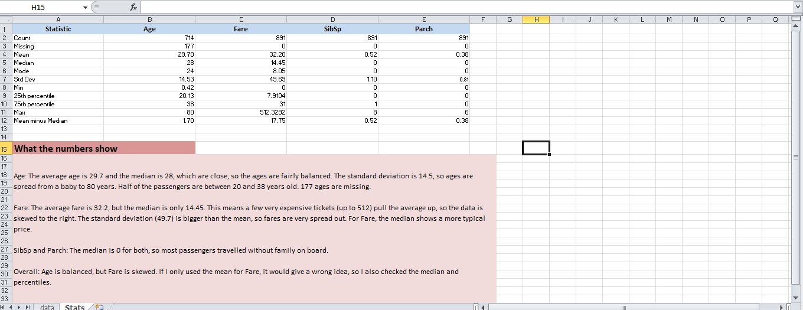

# Descriptive Statistics Primer: Titanic Dataset

## Overview
Summary statistics for four numeric columns of the Titanic dataset (891 passengers),
with a short write-up on what the numbers say about skew and spread.

## Columns analysed
Age, Fare, SibSp (siblings/spouses aboard), Parch (parents/children aboard)

## Statistics calculated (Excel)
Count, missing values, mean, median, mode, standard deviation, min, 25th and
75th percentile, max, and mean minus median (a simple skew check)
Formulas used: COUNT, COUNTBLANK, AVERAGE, MEDIAN, MODE, STDEV, MIN, MAX, PERCENTILE

## Key findings
- Age: mean 29.7 and median 28 are close, so it is fairly balanced (177 missing)
- Fare: mean 32.2 is far above median 14.45, so it is skewed to the right;
  the median is a better "typical" fare
- SibSp and Parch: median 0, so most passengers travelled without family aboard

## Tools Used
Microsoft Excel

## Dataset
Titanic dataset (train.csv, Kaggle)

## Screenshot

